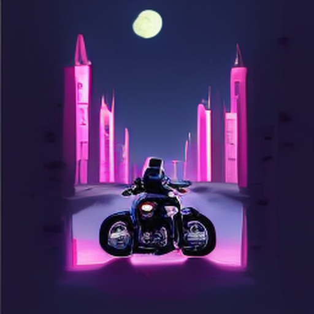

# Supra2-IMG cover-art experiment

Supra2-IMG is available as an **optional** cover-art model in Setup → Models & Engines. SD-Turbo remains the default. The selection is saved locally; switching it affects future cover renders and does not remove existing covers.

The image transformer has 104.1M parameters and generates 256×256 images. The full local pipeline also downloads Flan-T5-Base and the SD VAE, approximately 1.74 GB combined in this checkout. MusiGen runs the model on an NVIDIA GPU and enlarges its output to 512×512 with Lanczos for the existing library-card format. The enlargement does not add detail.

The reviewed inference implementation is based on SupraLabs' published [model card and inference script](https://huggingface.co/SupraLabs/Supra2-IMG). MusiGen implements the published DiT layers locally rather than executing downloaded Python, and loads the checkpoint with PyTorch's restricted `weights_only=True` mode.

## Local sample

On an RTX 4080, an end-to-end generation took about 11 seconds in a fresh process, including loading the components. The sample demonstrates the native model's 256px detail level:

In this small sample, the model followed the scene prompt, though early prompts produced inconsistent subjects and occasional pseudo-lettering. Cover prompts now avoid asking the model to render a title and explicitly request artwork without text. Treat the feature as experimental and compare its results with SD-Turbo before choosing it for everyday use.
